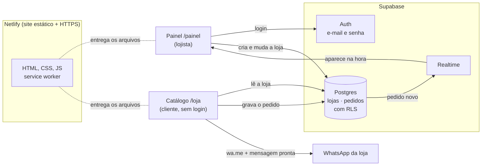

# Vitrine Zap: microSaaS com PWA

**Aluno:** João Pedro Neves · **Disciplina:** _[preencher]_ · **Professor(a):** _[preencher]_ · **Entrega:** novembro de 2026

**Site:** <https://vitrine-zap.netlify.app/> _(confirmar o endereço depois de publicar)_

---

## 1. Resumo

O Vitrine Zap é um microSaaS que cria o **catálogo digital** de pequenos comércios que vendem pelo WhatsApp
(empórios, floriculturas, confeitarias, restaurantes). O cliente escolhe os produtos, monta a sacola e o pedido
chega **pronto no WhatsApp da loja**, com itens, total, entrega ou retirada, endereço e forma de pagamento. O mesmo
catálogo funciona como **cardápio de mesa por QR code** em restaurantes. O lojista entra num **painel que instala
como app (PWA)**, cuida dos produtos e vê os pedidos chegando **ao vivo**. A receita vem de **assinatura mensal**, sem
comissão por pedido. O modelo é de **implantação assistida**: a Neves Tecnologia monta a loja e cria o acesso de
cada cliente (não há cadastro aberto pelo site), e quem atrasa a mensalidade tem a loja pausada.

O front-end é estático e fica no **Netlify**; banco de dados, login e tempo real ficam no **Supabase**.

A ideia nasceu de um trabalho real: um catálogo com pedido pelo WhatsApp que a Neves Tecnologia já mantém para um
empório no Sul de Minas. Este projeto transforma esse serviço feito sob medida num produto que qualquer loja usa
sozinha.

## 2. O problema

No comércio pequeno do interior, o WhatsApp é o balcão. Isso traz três dores:

1. **Atendimento repetitivo.** “Tem queijo canastra? Quanto tá?” O dono para o trabalho pra mandar foto e preço,
   um cliente de cada vez.
2. **Pedido bagunçado.** Itens espalhados em várias mensagens, endereço incompleto, troco esquecido. Cada erro
   vira retrabalho e cliente chateado.
3. **Cardápio que não acompanha a loja.** O PDF pesa e desatualiza; o de papel na mesa suja e não mostra o que
   acabou. Mudar um preço significa imprimir tudo de novo.

As alternativas que existem não servem bem a esse público: as plataformas de delivery cobram comissão por pedido e
ficam com o relacionamento do cliente; as lojas virtuais completas são caras e complicadas para quem fecha a venda
conversando.

## 3. Público-alvo

Comércios locais pequenos (1 a 10 pessoas) que **já vendem pelo WhatsApp** e não querem trocar isso: empórios e
mercearias, floriculturas, confeitarias, cestas de presente, hortifrútis e restaurantes ou bares com mesas.

| Persona | Situação | O que o Vitrine Zap resolve |
| --- | --- | --- |
| **Dona Rosa**, empório | Responde preço e foto o dia todo; o queijo acaba e ela esquece de avisar. | Link do catálogo na bio e no status; esgota o produto com um toque. |
| **Lucas**, floricultura | Precisa de data, período, nome de quem recebe e mensagem do cartão em todo pedido. | Liga as “perguntas do pedido” e tudo chega na mensagem. |
| **Seu Zé**, restaurante | Cardápio de papel engordurado; muda o preço e reimprime. | Um QR por mesa; o preço muda no painel e o cardápio muda na hora. |
| **O cliente final** | Quer ver tudo com calma, sem baixar app, e mandar o pedido certo. | Abre pelo link ou QR, monta a sacola e envia pelo WhatsApp. |

## 4. A solução (o que foi entregue)

- **Landing page** (`/`): proposta de valor, os dois modos de uso, para quem é, recursos, lojas de exemplo
  (com um celular de demonstração funcionando na própria página), planos e perguntas frequentes.
- **Catálogo da loja** (`/loja/?l=SLUG`): busca, categorias com destaque da que está na tela, “mais pedidos”,
  esgotados no fim da lista, detalhe do produto com link próprio, sacola que não some ao fechar a página, cálculo
  de total e taxa de entrega, formulário com as perguntas da loja e envio pelo WhatsApp (`wa.me`). O pedido também
  é gravado no banco para aparecer no painel.
- **Cardápio de mesa** (`/loja/?l=SLUG&mesa=7`): o mesmo catálogo em lista, sem sacola, com o número da mesa.
- **Painel do lojista** (`/painel/`): login com o e-mail e a senha criados pela Neves Tecnologia, criação da loja
  em quatro perguntas ou a partir de uma loja de exemplo, produtos (nome, preço, categoria, descrição, foto reduzida no
  próprio aparelho ou ícone, à venda, destaque), categorias, **pedidos ao vivo** (novo, confirmado, entregue),
  QR code do balcão, QR de cada mesa com plaquinhas para imprimir, e configurações (contato, entrega, taxa,
  pagamentos, perguntas do pedido, cor e ícone da loja, exportar e importar os dados).
- **PWA**: instala no celular e no computador, abre offline e avisa quando há versão nova (seção 8).

- **Painel de demonstração** (`/painel/?demo=1`): o mesmo painel sem conta, com as mudanças salvas só no
  navegador, para mostrar o produto a quem ainda não é cliente.

Sem as chaves do Supabase o app inteiro roda em **modo demonstração**, com tudo salvo no navegador.

## 5. Por que é um microSaaS

- **Nicho bem definido:** comércio local que vende pelo WhatsApp, começando pelo Sul de Minas.
- **Receita recorrente:** assinatura mensal, sem comissão.
- **Produto enxuto:** resolve um problema só (do catálogo ao pedido pronto) e evita o que encarece (pagamento
  online, estoque integrado, app nas lojas de aplicativos).
- **Operação de uma pessoa:** sem servidor próprio para manter. Front-end estático numa CDN (Netlify) e banco
  gerenciado (Supabase), os dois com plano gratuito para começar. O painel do Supabase serve de administração.
- **Venda assistida (*sales-led*):** o público (dono de empório, floricultura, restaurante) prefere que alguém
  monte a loja. Por isso a Neves Tecnologia faz a implantação e cria o acesso; o software é o mesmo para todos os
  clientes (multi-loja) e a receita é recorrente. SaaS não exige cadastro aberto: o que o define é o software
  entregue como serviço, por assinatura. Um plano de autoatendimento fica como possibilidade futura.

## 6. Modelo de negócio

### Planos

| Plano | Preço | Para quem | Inclui |
| --- | --- | --- | --- |
| Catálogo no WhatsApp | R$ 89/mês | Empórios, floriculturas, confeitarias, cestas | Implantação (produtos e fotos), link e QR do balcão, pedido no WhatsApp, perguntas do pedido, painel, suporte |
| Catálogo + Cardápio de mesa | R$ 119/mês | Restaurantes, bares, cafés | Tudo do anterior + cardápio de mesa com QR por mesa e plaquinhas impressas |

Implantação inclusa e sem fidelidade. O rodapé de cada catálogo tem o selo “Catálogo feito com Vitrine Zap: quer um
pra sua loja?”, que leva os clientes da loja (muitas vezes também comerciantes) para a página de planos.

### Operação

1. **Venda:** o lojista chama no WhatsApp pelo botão “Quero minha loja” ou recebe uma demonstração.
2. **Implantação:** a Neves Tecnologia cria o acesso dele no Supabase (Authentication → Users), entra no painel,
   monta a loja com os produtos e as fotos e imprime as plaquinhas.
3. **Uso:** o lojista recebe o e-mail e a senha e passa a cuidar dos preços, do que acabou e dos pedidos.
4. **Cobrança:** mensalidade por Pix ou boleto. Se atrasar, a loja é pausada (coluna `ativa` = false no banco):
   o catálogo sai do ar, para de receber pedidos e o painel avisa o lojista. Pagou, volta na hora.

### Canais

- Prospecção ativa: lista de comércios da região a partir do Google Maps, com uma demonstração personalizada da
  loja de cada um enviada pelo WhatsApp (o processo que a Neves Tecnologia já usa).
- Selo no rodapé dos catálogos e indicação de clientes.
- Painel de demonstração aberto, para o lojista ver como é antes de fechar.
- Instagram com antes e depois de lojas reais.

### Custos

| Item | Para começar | Quando crescer |
| --- | --- | --- |
| Hospedagem do site (Netlify) | plano gratuito | plano pago por tráfego |
| Banco, login e tempo real (Supabase) | plano gratuito | plano Pro, com mais banco e backups |
| WhatsApp | R$ 0 (link `wa.me`, sem API paga) | R$ 0 |
| Domínio | opcional | registro `.com.br` por ano |

Como o site é estático e não usa API paga de mensagens, o custo por cliente é muito baixo: quase toda a
mensalidade é margem.

### Métricas acompanhadas

- **MRR** (receita recorrente mensal) e número de lojas pagantes por plano.
- **Conversão** de demonstrações enviadas em clientes, **churn** (cancelamentos por mês) e lojas pausadas por atraso.
- **Pedidos por loja** por semana: mostra se o produto está trazendo venda (é o que segura o cliente). Já fica
  registrado na tabela `pedidos`.
- **CAC** (custo para conquistar uma loja, incluindo a hora da implantação) comparado ao **LTV** (ticket médio ÷
  churn). Exemplo: ticket médio de R$ 95 com 5% de churn ao mês dá LTV de R$ 1.900.

### Projeção simples

Com 40 lojas no Catálogo no WhatsApp e 10 no Catálogo + Cardápio de mesa: 40 × R$ 89 + 10 × R$ 119 =
**R$ 4.750 por mês**, com custo de infraestrutura perto de zero no começo.

## 7. Concorrência e diferencial

| Alternativa | Ponto forte | Onde deixa a desejar para este público |
| --- | --- | --- |
| Catálogo do próprio WhatsApp Business | Grátis e conhecido | Preso dentro do app, sem link com a cara da loja e sem as perguntas de cada negócio |
| Plataformas de delivery | Trazem clientes novos | Comissão por pedido; o cliente é da plataforma |
| Cardápio em PDF ou foto | Grátis | Pesado, desatualiza, não marca o que acabou |
| Lojas virtuais completas | Muitos recursos | Caras e complexas para quem fecha a venda conversando |

**Diferencial:** feito para quem fecha a venda no WhatsApp e quer continuar assim; pedido e cardápio de mesa no
mesmo produto; perguntas do pedido por tipo de negócio; sem comissão; funciona offline e no 4G fraco.

## 8. PWA: requisitos atendidos

| Requisito | Como foi feito | Arquivo |
| --- | --- | --- |
| Manifesto | Nome, nome curto, descrição, `start_url` no painel, `scope`, `display: standalone`, cores, ícones 192/512, ícone *maskable* para Android, SVG, atalhos (Produtos, Pedidos, QR codes) e telas para a janela de instalação | `manifest.webmanifest` |
| Service worker | Na instalação guarda todos os arquivos do app; depois usa **rede primeiro com tempo limite de 3,5 s** e cai na cópia guardada; páginas guardadas sem os parâmetros (`?l=`), porque o HTML é o mesmo para todas as lojas; guarda também a biblioteca do Supabase e os catálogos lidos da nuvem; página `offline.html` quando não há cópia | `sw.js` |
| Atualização | Versão nova espera; o app mostra “Saiu uma versão nova · Atualizar”; no toque, o service worker novo assume, a página recarrega e o cache antigo é apagado | `sw.js`, `js/pwa.js` |
| Instalação | Botão “Instalar app” com o evento `beforeinstallprompt`; no iPhone, passo a passo do “Adicionar à Tela de Início”; o item some quando o app já está instalado (`display-mode: standalone`) | `js/pwa.js` |
| HTTPS | Netlify (com certificado automático); no computador, `localhost` | `netlify.toml`, `_headers` |
| Offline | Painel e catálogos já abertos funcionam sem internet; cópia das lojas no IndexedDB; mudança feita offline fica **pendente** e sobe para o Supabase quando a conexão volta; faixa “Sem internet” | `js/banco.js`, `js/painel.js`, `js/pwa.js` |
| Armazenamento | IndexedDB (lojas, produtos com fotos, pedidos do modo demonstração); `localStorage` para a sacola e a sessão; `navigator.storage.persist()` para o navegador não apagar os dados | `js/banco.js` |
| Responsivo e acessível | Pensado primeiro para celular; menu embaixo no celular e na lateral no computador; tema claro e escuro; rótulos, foco visível, `aria-live` nos avisos, movimento reduzido | `css/app.css` |
| Recursos nativos | Web Share (divulgar link e produto), Clipboard (copiar link), BroadcastChannel (o catálogo aberto em outra aba se atualiza quando o painel salva), impressão das plaquinhas, câmera/galeria para fotos dos produtos | `js/util.js`, `js/painel.js`, `js/loja.js` |

## 9. Arquitetura



- **Sem servidor próprio:** o navegador fala direto com o Supabase. Quem protege os dados são as regras de acesso
  do banco (seção 10), não um back-end escondido.
- **Uma camada de dados:** `js/nuvem.js` (Supabase) e `js/banco.js` (IndexedDB) ficam atrás das mesmas funções do
  painel e do catálogo. Sem as chaves no `js/config.js`, o app usa só o navegador (modo demonstração).
- **Mensagem do WhatsApp** montada por uma função só (`montarMensagem`), usada no catálogo e no exemplo da landing.
- **Dependências:** só a biblioteca oficial do Supabase (carregada quando ele está ligado e guardada para uso
  offline). O QR code é gerado por um código próprio (`js/qrcode.js`).

## 10. Segurança (Row Level Security)

As tabelas ficam em [`supabase/schema.sql`](../supabase/schema.sql). A chave usada no site é a pública (*anon*);
o que cada um pode fazer é decidido pelo próprio banco:

| Tabela | Ler | Criar | Mudar | Apagar |
| --- | --- | --- | --- | --- |
| `lojas` | qualquer pessoa, se a loja estiver ativa; o dono, sempre | lojista logado, sempre como dono | só o dono, e só o conteúdo (não muda o dono nem reativa a loja) | só o dono |
| `pedidos` | só o dono da loja | qualquer cliente, sem login, só em loja ativa e sempre como “novo” | só o dono da loja (situação) | só o dono da loja |

Outros cuidados:

- **Cadastro fechado:** a criação de contas pelo site fica desligada no Supabase; só a Neves Tecnologia cria
  acessos (no painel do Supabase, que usa a chave secreta e não passa pelo site).
- **Permissão por coluna:** o lojista só pode gravar `slug` e `dados`; `dono` e `ativa` ficam fora do alcance dele.
- O endereço da loja (`slug`) só aceita letras minúsculas, números e hífen; o pedido tem tamanho máximo; apagar a
  loja apaga os pedidos dela (`on delete cascade`); a chave secreta nunca vai para o site.

## 11. Roteiro para testar

1. Abra o site no computador. Na seção **Veja funcionando**, aponte a câmera do celular para o QR: abre o
   cardápio da **Mesa 7** do restaurante de exemplo, como o cliente veria na mesa.
2. No computador, abra o **painel de demonstração** (botão “Ver o painel por dentro”) e mexa à vontade: preços,
   produtos esgotados, QR codes. Nada disso precisa de conta.
3. Para o fluxo completo, entre no painel com a conta de teste que o aluno criou (e-mail e senha entregues junto com
   a atividade). Em **QR codes**, aponte o celular para o QR da loja: o catálogo abre no celular, porque a loja está
   no Supabase.
4. No celular, toque em **+** em alguns produtos, abra a sacola, preencha e toque em **Enviar pedido pelo
   WhatsApp**. O WhatsApp abre com o pedido pronto e, ao mesmo tempo, o pedido **aparece no painel do computador**
   (aba **Pedidos**, com aviso e bolinha de “novo”).
5. No painel, mude um preço e marque um produto como esgotado. Recarregue o catálogo no celular: já mudou.
6. Em **QR codes**, ponha o número de mesas e toque em **Imprimir plaquinhas** (dá pra salvar em PDF).
7. Instale: botão **Instalar app** no Chrome ou Edge; no iPhone, Compartilhar → Adicionar à Tela de Início.
8. Teste offline: modo avião (ou DevTools → Application → Service workers → Offline) e recarregue. O painel abre
   com a cópia guardada, aceita mudanças e sobe tudo quando a internet volta.
9. No DevTools, aba **Application**: manifesto, service worker, Cache Storage e IndexedDB. No Supabase, as
   tabelas `lojas` e `pedidos` com os dados do teste.

**Teste automatizado do QR code:** `node testes/qrcode.test.mjs` lê cada QR de volta seguindo a norma
(ISO/IEC 18004), com as tabelas oficiais, e confere o texto em todos os níveis de correção e todas as máscaras.

## 12. Decisões técnicas

- **CSS próprio em vez de framework:** um arquivo só, pequeno, guardado no cache; nada de script de CDN que pesaria
  no 4G da mesa do restaurante.
- **Rede primeiro no service worker:** o preço que o lojista mudou aparece na hora para quem está online; o cache
  é para quando a rede falha ou demora.
- **Loja inteira num campo JSON** (`lojas.dados`): o mesmo formato que o app já usa no aparelho, então o painel
  salva e o catálogo lê sem conversão. Pedidos ficam numa tabela própria para o Realtime e as métricas.
- **QR code feito do zero:** o painel gera as plaquinhas das mesas sem internet e sem biblioteca de terceiros. O
  teste automatizado garante que os códigos seguem a norma.
- **Fotos reduzidas no aparelho** (até 800 px, WebP) antes de salvar: economiza banco e dados móveis.
- **Pedido por `wa.me`:** funciona com WhatsApp normal ou Business, sem API paga e sem custo por mensagem.

## 13. Limitações e próximos passos

Esta entrega é o **MVP**. Ficou de fora, de propósito:

1. **Fotos no Supabase Storage** em vez de dentro do JSON da loja (hoje cada foto vai junto com a loja).
2. **Cobrança automática da mensalidade** (Pix recorrente ou cartão) pausando a loja sozinha quando atrasar; hoje a
   cobrança é manual e a pausa é feita no painel do Supabase.
3. **Tela de administração própria** (clientes, lojas, pagamentos) e **troca de senha** pelo próprio lojista.
4. **Endereço próprio** por loja (`sualoja.com.br`) e prévia do link com a foto da loja.
5. **Opções por produto** (tamanho, sabor, adicionais) para lanchonete, pizzaria e açaí, e **taxa de entrega por
   bairro**.
6. **Painel de métricas**: pedidos por semana, produtos mais pedidos, de onde vêm os clientes.

## 14. Como rodar

Local, sem conta em nada (modo demonstração):

```bash
python -m http.server 8080
```

Abra <http://localhost:8080>. Para ligar o Supabase e publicar no Netlify, siga o [README](../README.md#configurar-o-supabase).
